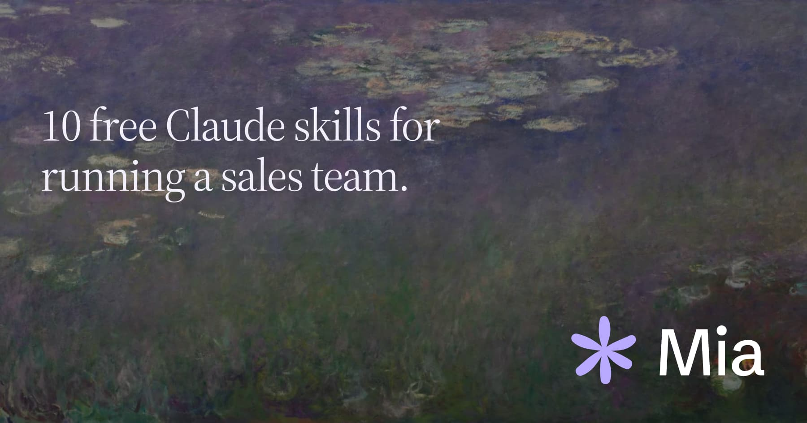
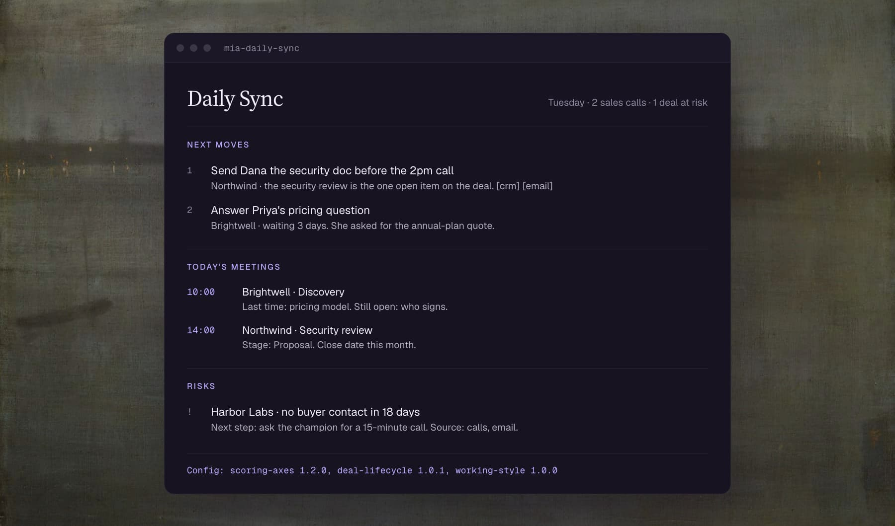
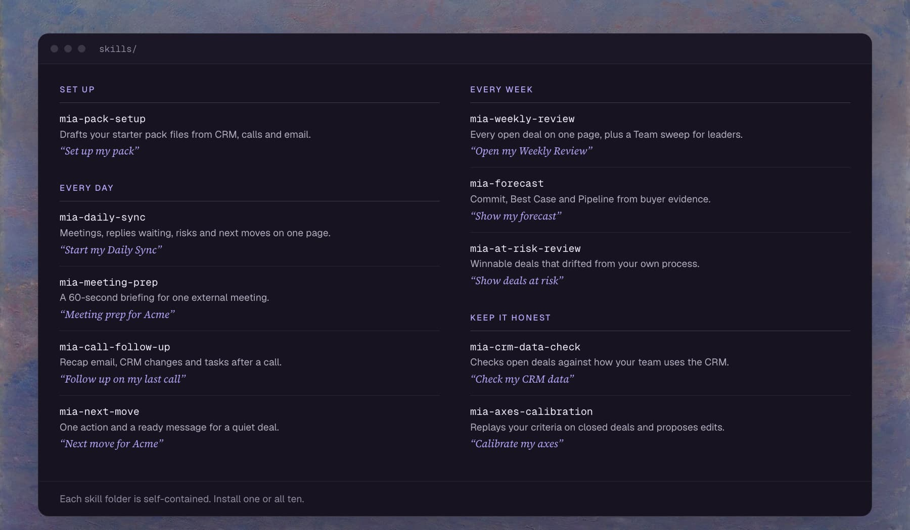
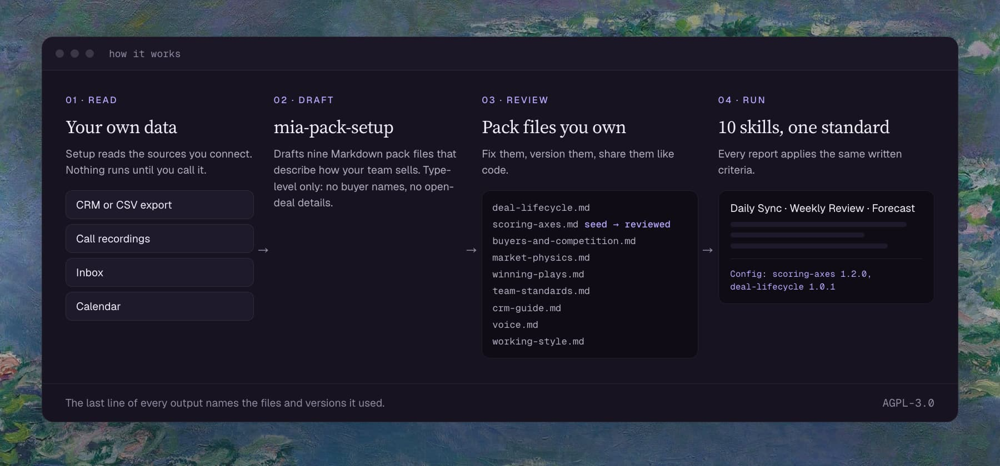

# Mia Open Sales Skills

<p align="center"></p>

 

One rep calls a deal Commit. Another calls the same deal Best Case. Forecast calls turn into arguments about definitions.

Mia Open Sales Skills write your criteria down once, as plain Markdown. Ten skills (Daily Sync, Weekly Review, Forecast and more) judge every deal against those files, and every report prints the file versions it used.

<p align="center"></p>

## Quick start

**1. Install**

```
# Claude Code
/plugin marketplace add Additor/mia-open-sales-skills
/plugin install mia-open-sales-skills@mia-open-sales-skills

# Any coding agent
npx skills add Additor/mia-open-sales-skills
```

**2. Set up your pack.** Say `Set up my pack`. Answer a short opening question and confirm what it found in your CRM, calls and email. It writes the files to `mia-pack/`.

**3. Run something.** Say `Start my Daily Sync`.

No CRM connection yet? Attach a CSV export of your deals and the skills treat it as the CRM. Leading a team? See [Team rollout](docs/guide.md#team-rollout).

## Why this exists

| Problem | What the pack does |
|---|---|
| Process lives in a leader's head | `deal-lifecycle.md` and `team-standards.md` write it down, in plain text you can diff |
| Reports sound confident and cite nothing | Every fact carries a source and a date. Unchecked claims read "unconfirmed" |
| Two reps run different versions of the rules | Every report ends with a `Config:` line naming the file versions it used |
| Tools lock you in | The pack is Markdown. It runs in Claude and in any AI tool that reads files |

## Skills

<p align="center"></p>

<details>
<summary>All ten skills, with links</summary>

- [mia-pack-setup](skills/mia-pack-setup/SKILL.md): builds your pack files from your CRM, calls and email
- [mia-daily-sync](skills/mia-daily-sync/SKILL.md): one-screen page with today's meetings, replies waiting, risks and next moves
- [mia-meeting-prep](skills/mia-meeting-prep/SKILL.md): a 60-second briefing for one external meeting
- [mia-call-follow-up](skills/mia-call-follow-up/SKILL.md): recap email draft, CRM change proposal and dated tasks for the call that just ended
- [mia-next-move](skills/mia-next-move/SKILL.md): one specific action and a ready-to-send message for a quiet deal
- [mia-weekly-review](skills/mia-weekly-review/SKILL.md): every open deal on one page, with a Team sweep and Coach's questions for leaders
- [mia-forecast](skills/mia-forecast/SKILL.md): Commit, Best Case and Pipeline sorted from buyer evidence, set beside the CRM commit
- [mia-at-risk-review](skills/mia-at-risk-review/SKILL.md): winnable deals that drifted from your own process, with a dollar figure on the gaps
- [mia-crm-data-check](skills/mia-crm-data-check/SKILL.md): learns how your team uses the CRM, checks open deals against it, and prepares fixes for approval
- [mia-axes-calibration](skills/mia-axes-calibration/SKILL.md): replays your scoring criteria on closed deals and proposes edits where outcomes disagree

</details>

## How it works

<p align="center"></p>

## Install

| Where | How |
|---|---|
| Claude Code, plugin | `/plugin marketplace add Additor/mia-open-sales-skills` then `/plugin install mia-open-sales-skills@mia-open-sales-skills` |
| Any coding agent | `npx skills add Additor/mia-open-sales-skills` |
| Codex, manual | Copy `skills/*` to `.agents/skills/` (repository) or `~/.agents/skills/` (user) |
| Claude Code, manual | Copy `skills/*` to `.claude/skills/` or `~/.claude/skills/` |
| Claude on the web or desktop | Zip a folder from `skills/` and upload it as a custom skill. Install `mia-pack-setup` first |
| Any other AI tool | Paste a skill's `SKILL.md` into the instructions and attach that folder's `config/` and `assets/` files |

Each folder in `skills/` is self-contained, so you can install one skill or all ten. Where pack files and reports live in each tool: [docs/environments.md](docs/environments.md).

## More

[Team rollout](docs/guide.md#team-rollout) · [Customize](docs/guide.md#customize) · [Safety and privacy](docs/guide.md#safety-and-privacy) · [Pack files](docs/pack-files.md) · [Using it in your tool](docs/environments.md) · [Contributing](CONTRIBUTING.md)

## License

[AGPL-3.0-only](LICENSE). Copyright 2026 Withmia.

Use it inside your company freely. If you distribute a modified copy, or run one as a service for others, publish your modified source under the same license. The LICENSE file is the binding text.
